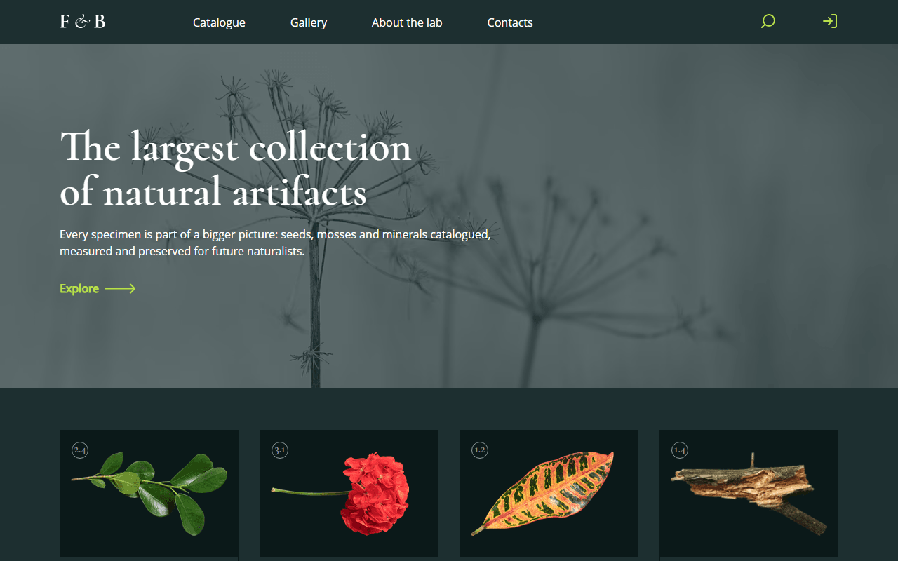

# F&B — Natural Artifacts Collection

A responsive landing page for a fictional natural history lab that collects plants, mosses and other natural artifacts. Learning project: pixel-accurate layout from a design mockup, built with a modular HTML/SCSS structure.



**Live demo:** https://kolesander-2020.github.io/fb-natural-collection/

## Stack

- HTML5 (partials via `vite-plugin-html-inject`)
- SCSS (modules, variables, mixins), PostCSS (Autoprefixer, px → rem, sorted media queries)
- JavaScript (ES modules)
- [Vite](https://vitejs.dev/)
- [Splide](https://splidejs.com/) — gallery slider
- [Pristine](https://pristine.js.org/) — form validation
- Responsive images: AVIF / WebP / PNG with `@1x` / `@2x`, SVG sprite

## Features

- Mobile-first responsive layout (375 → 1280+)
- Burger menu on mobile with `aria-expanded`, closes on link click and Esc
- Looping slider with custom arrows and a slide counter
- Subscription form with client-side validation
- Image optimisation at build time

## Getting started

```bash
npm i
npm run dev      # dev server
npm run build    # production build to dist/
npm run preview  # preview the build
```

---

Based on [Vite starter template](https://github.com/Grinch3214/vite-builder) by Maksym Hrichina.
